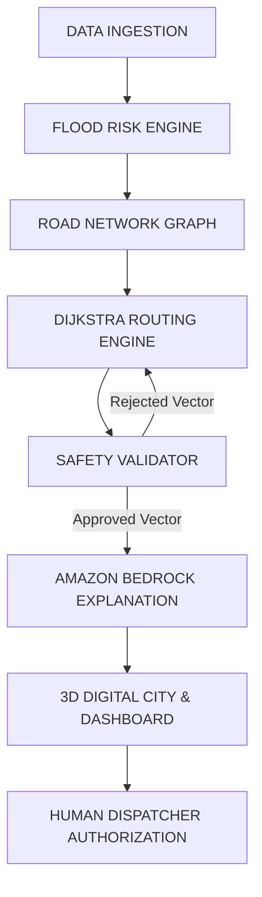

# FloodRoute — System Architecture & Design Specification

> "When Roads Fail. Relief Keeps Moving."

FloodRoute is an enterprise disaster mobility management platform engineered to keep ambulances, rescue vehicles, and relief supplies moving when urban flooding renders street networks impassable.

---

## 1. End-to-End Operational Pipeline



### 1.1 Strict AI Safety Contract

1. **Deterministic Priority:** The LLM (Amazon Bedrock) **never** independently computes routes, selects waypoints, or overrides road closure status.
2. **Order of Operations:**
   - Routing engine calculates candidate paths.
   - Physical safety validator eliminates impassable/submerged roads.
   - Deterministic route selection produces an approved vector.
   - Validated facts (candidate routes, water depth, vehicle clearance, ETAs) are supplied to Amazon Bedrock.
   - Bedrock formats a structured emergency operational briefing and trade-off explanation.
   - Schema validation rejects any model hallucinations.

---

## 2. Geospatial Taxonomy & Data Governance

FloodRoute strictly differentiates between pavement water levels and topographic datum:

| Data Stream | Unit & Measurement | Behavior |
| :--- | :--- | :--- |
| **Surface Inundation** | `Centimeters (cm)` on asphalt | Compared directly against vehicle ground clearance (e.g. 60cm limit for AMB-001). |
| **Pavement Grade** | `Meters (+MSL)` above sea level | Identifies elevated flyovers (e.g. Lalbaug Flyover at +14.5m MSL). |
| **River Gauge Telemetry** | `Meters (MSL)` river stage datum | Meteorological advisory only; never conflated with street water depth. |
| **Simulation Overlay** | Quarantined scenario tag | Strictly isolated from official municipal databases. |

---

## 3. Dynamic Road Graph & Routing Engine

### Graph Representation
* **Nodes ($V$):** Road intersections and viaduct ramps with $(x, y)$ coordinates and MSL elevation.
* **Edges ($E$):** Street corridors and elevated decks with length (km), speed limits (km/h), passability flag, current surface water depth (cm), and flood state.

### Dijkstra Cost Function
$$Cost(e) = \left(\frac{Length_{km}}{Speed_{km/h}} \times 60\right) \times W_{type} + (RiskScore \times 10)$$

* $W_{type} = 0.90$ for elevated viaducts (encourages safe grade separation).
* $W_{type} = 2.50$ for high-risk chronic lowland corridors.
* If $WaterDepth_{cm} > Clearance_{cm}$ or $State = BLOCKED$, $Cost(e) = \infty$.

---

## 4. Multi-Vehicle Independent Coordination

The platform coordinates multiple emergency units simultaneously without cross-route interference:

```
[BKC Logistics Depot]
    ├── AMB-001 (Ambulance) ---> [Sion] ---> [R-12: Hindmata] (BLOCKED!)
    │                                └── [Lalbaug Flyover Bypass] ---> [KEM Hospital]
    │
    └── REL-001 (Relief Truck) -> [East Causeway] --------------> [Relief Shelter]
                                  (Unaffected, continues on path)
```

1. **Ambulance (AMB-001):** Ground clearance 60cm. When R-12 crests at 85cm (+25cm deficit), AMB-001 halts before the breach, receives an automated reroute, and smoothly turns onto the Lalbaug Viaduct (+14.5m MSL).
2. **Relief Truck (REL-001):** High-clearance heavy transporter (80cm clearance) traveling to Sector 4 Relief Shelter via the independent Grand East Causeway. Remains nominal and unaffected.

---

## 5. Amazon Bedrock Integration Architecture

### Converse API Implementation
* **Client:** `@aws-sdk/client-bedrock-runtime`
* **Command:** `ConverseCommand`
* **Temperature:** `0.1` (deterministic, highly factual inference)
* **Response Schema:**
```json
{
  "summary": "The original route contains a blocked road.",
  "reason": "Road R-12 is marked impassable (85cm water depth > 60cm clearance).",
  "recommendation": "Use the validated alternative route.",
  "routeId": "ROUTE-BETA-ELEVATED",
  "routeName": "Route Beta (Lalbaug Elevated Viaduct Bypass)",
  "etaMinutes": 14.5,
  "riskScore": 0.05,
  "tradeOffAnalysis": {
    "timeImpactMinutes": 3.5,
    "safetyConfidencePct": 98.4,
    "elevationMarginMeters": 14.5
  }
}
```

---

## 6. Dual Visualization Layer: 3D City & 2D Tactical GIS

* **3D Digital City Diorama:**
  * Perspective 3D tilt with wet asphalt, glowing illuminated buildings, and elevation contours.
  * Real-time vector route paths: Restrained orange accents for emergency route, glowing emerald for safe corridor, red dashed hazard stripes for blocked R-12.
  * Smooth requestAnimationFrame vehicle animation following waypoints without teleportation.
* **2D Tactical GIS Map:**
  * Leaflet dark canvas with official municipal GIS layers (MCGM layers 344/345, CWC gauges, and facilities).
