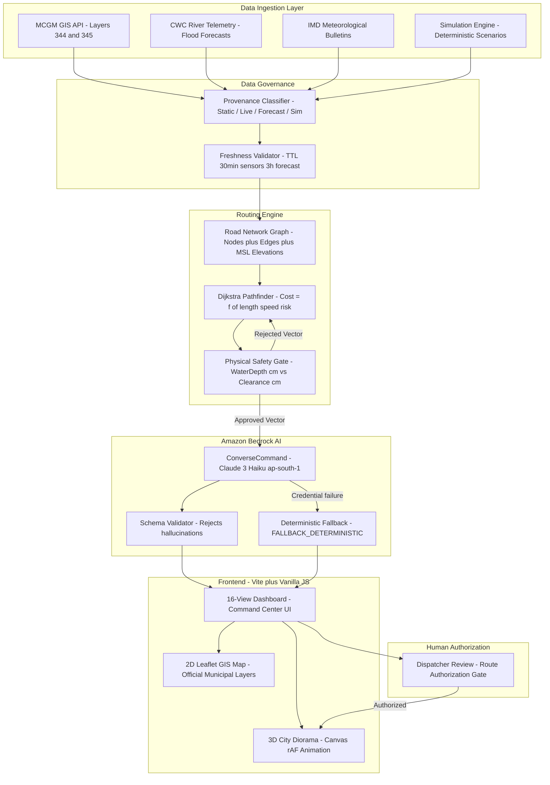

# FloodRoute — Enterprise AI Mobility & Disaster Relief Engine

> *"When Roads Fail. Relief Keeps Moving."*

FloodRoute is an enterprise disaster mobility management platform engineered to keep **ambulances, rescue vehicles, and relief supply trucks moving** when urban flooding renders street networks impassable. It dynamically reroutes emergency fleets using real municipal GIS data, deterministic Dijkstra pathfinding, and AI-powered operational briefings via Amazon Bedrock.

Built for the **AWS Environmental Hacks Hackathon** — addressing the urban flood mobility crisis across Indian metropolitan areas.

---

## Table of Contents

1. [Problem Statement](#1-problem-statement)
2. [Solution Overview](#2-solution-overview)
3. [Key Features](#3-key-features)
4. [System Architecture](#4-system-architecture)
5. [Technology Stack](#5-technology-stack)
6. [Repository Structure](#6-repository-structure)
7. [Local Installation](#7-local-installation)
8. [Environment Configuration](#8-environment-configuration)
9. [Running the Application](#9-running-the-application)
10. [AWS & Amazon Bedrock Setup](#10-aws--amazon-bedrock-setup)
11. [Simulation Mode & Deterministic Fallback](#11-simulation-mode--deterministic-fallback)
12. [Flood Simulation Demo](#12-flood-simulation-demo)
13. [Testing](#13-testing)
14. [Data Sources & Governance](#14-data-sources--governance)
15. [Security Practices](#15-security-practices)
16. [Implementation Status](#16-implementation-status)
17. [Troubleshooting](#17-troubleshooting)
18. [Hackathon Context](#18-hackathon-context)
19. [Roadmap](#19-roadmap)
20. [Contributing](#20-contributing)

---

## 1. Problem Statement

Urban flooding in Indian cities disrupts emergency response at the most critical moment. During acute flood events in Mumbai, Chennai, Bengaluru, Guwahati, Hyderabad, and Delhi:

- **Emergency vehicles cannot navigate** static pre-planned routes when roads are submerged.
- **Dispatchers have no real-time visibility** into which corridors are passable based on their vehicle ground clearance.
- **Municipal GIS data exists in silos** — MCGM, GCC, GHMC, and ASDMA datasets are authoritative but disconnected from operational dispatch systems.
- **AI systems without physical constraints** can hallucinate safe routes through flooded areas, creating life-threatening recommendations.

Every delayed ambulance minute during a flood event has measurable impact on patient survival rates.

---

## 2. Solution Overview

FloodRoute solves the emergency routing problem through a **strictly deterministic-first, AI-last** architecture:

1. **Ingest** real municipal GIS flood data (MCGM, GCC, CWC, IMD) with strict data provenance classification.
2. **Compute** flood-resilient routes using Dijkstra's algorithm with physical vehicle clearance constraints.
3. **Validate** every candidate route through a safety gate that eliminates impassable roads before AI is consulted.
4. **Brief** the dispatcher via Amazon Bedrock (Claude 3 Haiku) with a structured operational briefing — the AI formats facts, never computes routes.
5. **Authorize** deployment only after human dispatcher confirmation.
6. **Visualize** in both a photorealistic 3D city diorama and a 2D Leaflet tactical GIS map.

**The AI is a communication layer, not a decision engine.**

---

## 3. Key Features

### Implemented & Functional

| Feature | Description |
|---|---|
| **Dijkstra Flood-Resilient Routing** | Weighted graph pathfinding with vehicle ground clearance constraints (cost = Infinity for flooded roads) |
| **Multi-Vehicle Independent Coordination** | AMB-001 (Ambulance, 60cm clearance) and REL-001 (Relief Truck, 80cm clearance) routed independently |
| **Physical Safety Validator** | Rejects any route segment where water depth (cm) exceeds vehicle chassis clearance (cm) |
| **3D Digital City Diorama** | Perspective Canvas 3D visualization with wet asphalt, illuminated buildings, vehicle animations, and route corridors |
| **2D Leaflet Tactical GIS Map** | Dark-canvas Leaflet map with official MCGM (Layers 344/345), CWC gauges, and shelter overlays |
| **Flood Simulation Engine** | R-12 Hindmata Junction flood breach (85cm) with live reroute synthesis |
| **Amazon Bedrock Integration** | ConverseCommand via @aws-sdk/client-bedrock-runtime targeting Claude 3 Haiku in ap-south-1 |
| **Deterministic Fallback** | Full routing continues when Bedrock credentials or model access are unavailable |
| **6-City GIS Data** | Mumbai, Chennai, Bengaluru, Guwahati, Hyderabad, Delhi — official municipal source data |
| **16-View Dashboard** | Overview, Live Network, Incidents, Simulation, Analytics, Vehicles, Resources, Team, Settings, and more |
| **Data Provenance Taxonomy** | Strict separation: Static Risk / Live Observations / Forecasts / Community Reports / Simulation |
| **Automated Test Suite** | 11 unit and integration tests (Dijkstra, safety validation, Bedrock schema, fallback behavior) |

### Planned (Not Yet Implemented)

- Live municipal API polling (IMD, CWC endpoints require auth tokens)
- Real-time community SOS submission and dispatcher verification workflow
- Mobile responder HUD with GPS route guidance
- Multi-agency role-based access control (RBAC)
- Persistent incident database (currently in-memory)

---

## 4. System Architecture



### Routing Cost Function

```
Cost(edge) = (Length_km / Speed_km_h * 60) * W_type + (RiskScore * 10)

W_type = 0.90  for elevated viaducts (promotes safe grade separation)
W_type = 2.50  for high-risk chronic lowland corridors
Cost   = Infinity  if WaterDepth_cm > Clearance_cm OR State = BLOCKED
```

### AI Safety Contract

The LLM **never** computes routes, selects waypoints, or overrides road closure status:

1. Routing engine calculates candidate paths.
2. Physical safety validator eliminates impassable roads.
3. Deterministic route is finalized.
4. Validated facts (routes, depths, clearances, ETAs) are sent to Bedrock.
5. Bedrock returns a structured operational briefing.
6. Schema validation rejects any hallucinations.

---

## 5. Technology Stack

| Layer | Technology | Version |
|---|---|---|
| **Frontend Build** | Vite | ^6.2.0 |
| **Frontend Framework** | Vanilla JavaScript (ES Modules) | ES2022+ |
| **UI Styling** | Tailwind CSS (CDN) + custom CSS | v3 CDN |
| **Mapping** | Leaflet.js | ^1.9.4 |
| **3D Visualization** | HTML5 Canvas (custom rAF engine) | — |
| **Backend** | Express.js | ^5.3.0 |
| **AI Integration** | AWS SDK v3 Bedrock Runtime | ^3.1149.0 |
| **AI Model** | Anthropic Claude 3 Haiku | anthropic.claude-3-haiku-20240307-v1:0 |
| **AWS Region** | Asia Pacific (Mumbai) | ap-south-1 |
| **Runtime** | Node.js | v18+ / v20+ |
| **Config** | dotenv | ^18.0.7 |
| **Fonts** | Inter + JetBrains Mono (Google Fonts) | — |
| **GIS Data** | MCGM, GCC, CWC, IMD, ASDMA (official) | — |

---

## 6. Repository Structure

```
FLOODROUTE/
├── index.html                    # Entry HTML with Tailwind config, fonts, Leaflet CSS
├── vite.config.js               # Vite dev server (port 3000, proxies to port 4000)
├── package.json                 # npm scripts and dependencies
├── .env.example                 # Sanitized environment template (safe to commit)
├── .env                         # Local secrets — NOT committed to Git
│
├── src/                         # Frontend source (Vanilla JS ES Modules)
│   ├── main.js                  # App bootstrap, router, state wiring
│   ├── style.css                # Global CSS variables and base styles
│   ├── components/
│   │   ├── City3DScene.js       # Canvas 3D city diorama with vehicle animation
│   │   ├── Header.js            # Global navigation header
│   │   ├── TacticalMap.js       # Leaflet 2D GIS tactical map
│   │   ├── Modals.js            # Shared modal components
│   │   ├── RerouteModal.js      # Route recalculation modal
│   │   ├── ScenarioBanner.js    # Simulation scenario overlay banner
│   │   └── SourceLegendDrawer.js# Data source legend panel
│   ├── views/                   # 16 application views
│   │   ├── OverviewView.js      # Command center dashboard
│   │   ├── LiveNetworkView.js   # Live network + 3D diorama + 2D GIS
│   │   ├── SimulationView.js    # Flood simulation event replay
│   │   ├── IncidentsView.js     # Incidents list
│   │   ├── IncidentDetailView.js# Incident detail and dispatch
│   │   ├── AnalyticsView.js     # Operational analytics and reports
│   │   ├── VehiclesView.js      # Fleet management
│   │   ├── ResourcesView.js     # Community needs and relief resources
│   │   ├── ResponderHudView.js  # Field responder tactical HUD
│   │   ├── PublicHelpView.js    # Public emergency help and shelter directory
│   │   ├── TeamView.js          # Team directory and role governance
│   │   ├── AuthView.js          # Sign-in and tactical auth
│   │   ├── IntegrationsView.js  # Data source integrations
│   │   ├── SettingsView.js      # Workspace settings and usage limits
│   │   ├── AuditLogView.js      # Compliance audit log
│   │   └── OnboardingView.js    # Organization onboarding
│   ├── services/
│   │   ├── routingService.js    # Client-side routing orchestration
│   │   ├── routerEngine.js      # Dijkstra algorithm implementation
│   │   └── providers/
│   │       ├── baseProvider.js       # Abstract provider interface
│   │       ├── officialDataStore.js  # Municipal GIS data store
│   │       └── providerRegistry.js   # Provider routing and city data
│   ├── geo/
│   │   ├── cities.js            # 6-city road network graphs and flood data
│   │   └── official_data/
│   │       ├── mcgm_features.json   # MCGM GIS features snapshot
│   │       └── gcc_features.json    # GCC GIS features snapshot
│   ├── data/
│   │   └── seedData.js          # Application seed data (incidents, vehicles)
│   ├── models/
│   │   └── provenance.js        # Data provenance taxonomy models
│   └── state/
│       └── store.js             # Global application state management
│
├── server/                      # Express.js backend
│   ├── index.js                 # Server entry: routes, CORS, env config
│   ├── config.js                # Server configuration loader
│   ├── ai/
│   │   └── bedrockProvider.js   # AWS Bedrock ConverseCommand integration
│   ├── routing/
│   │   ├── graph.js             # Server-side road network graph
│   │   └── safetyValidator.js   # Physical safety validation engine
│   └── simulation/
│       └── engine.js            # Flood scenario simulation state machine
│
├── tests/
│   └── floodroute.test.js       # 11 automated tests (Node.js test runner)
│
├── screens/                     # UI design screenshots (17 screens)
│   └── manifest.json
│
├── public/assets/               # Static public assets
│
├── AWS_SETUP.md                 # AWS IAM, Bedrock model access, auth guide
├── DEMO_RUNBOOK.md              # Step-by-step hackathon demo guide
└── FLOODROUTE_ARCHITECTURE.md   # System architecture and design specification
```

---

## 7. Local Installation

### Prerequisites

- Node.js v18.x or v20.x or later
- npm v9+ (bundled with Node.js)
- Git
- AWS credentials (optional — see Simulation Mode section)

### Steps

```bash
# 1. Clone the repository
git clone https://github.com/pratyushwakde24-source/Floodroute-.git
cd Floodroute-

# 2. Install dependencies
npm install

# 3. Configure environment
cp .env.example .env
# Edit .env and fill in your AWS credentials if using live Bedrock
```

---

## 8. Environment Configuration

Copy `.env.example` to `.env` and configure as needed:

```bash
cp .env.example .env
```

Key variables:

| Variable | Default | Description |
|---|---|---|
| `NODE_ENV` | `development` | Environment mode |
| `PORT` | `4000` | Backend server port |
| `HOST` | `0.0.0.0` | Backend bind host |
| `AWS_REGION` | `ap-south-1` | AWS region (Mumbai — matches pilot city) |
| `BEDROCK_MODEL_ID` | `anthropic.claude-3-haiku-20240307-v1:0` | Bedrock model identifier |
| `AI_PROVIDER` | `bedrock` | AI provider selection |
| `SIMULATION_MODE` | `true` | Enable deterministic simulation (no AWS required) |
| `AWS_ACCESS_KEY_ID` | *(empty)* | IAM access key — local .env only, never commit |
| `AWS_SECRET_ACCESS_KEY` | *(empty)* | IAM secret key — local .env only, never commit |
| `AWS_SESSION_TOKEN` | *(empty)* | Temporary session token (if using STS/SSO) |
| `IMD_API_KEY` | *(empty)* | India Meteorological Dept API key (optional) |
| `CWC_AUTH_TOKEN` | *(empty)* | Central Water Commission auth token (optional) |

**Security:** Never commit `.env` with real credentials. The `.gitignore` excludes `.env` automatically. Only `.env.example` (with empty/placeholder values) is tracked.

---

## 9. Running the Application

FloodRoute requires two processes: a Vite frontend (port 3000) and an Express backend (port 4000).

### Terminal 1 — Start Backend (AWS/AI + Routing API)

```bash
npm run server
```

Expected output:
```
[FloodRoute Backend] Running on http://0.0.0.0:4000
[FloodRoute Backend] AWS Region: ap-south-1 | Bedrock Model: anthropic.claude-3-haiku-20240307-v1:0
[FloodRoute Backend] Simulation Mode: true
```

### Terminal 2 — Start Frontend (Vite Dev Server)

```bash
npm run dev
```

Open your browser at **http://localhost:3000**.

The Vite dev server proxies all `/api/*` requests to the backend on port 4000 (configured in `vite.config.js`).

### Available npm Scripts

| Command | Description |
|---|---|
| `npm run dev` | Start Vite frontend dev server (port 3000, with HMR) |
| `npm run server` | Start Express backend server (port 4000) |
| `npm start` | Alias for `npm run server` |
| `npm run build` | Build production frontend bundle to `dist/` |
| `npm run preview` | Preview production build locally |
| `npm test` | Run automated test suite (Node.js native test runner) |

---

## 10. AWS & Amazon Bedrock Setup

See **[AWS_SETUP.md](./AWS_SETUP.md)** for the complete guide, including:
- Enabling Bedrock model access in the AWS Console (ap-south-1)
- Least-privilege IAM policy (only `bedrock:InvokeModel` and `bedrock:InvokeModelWithResponseStream`)
- Authentication options (AWS CLI SSO, environment variables, instance profiles)

**Quick summary:**

1. AWS Console → Amazon Bedrock → Model access → Enable Claude 3 Haiku in `ap-south-1`
2. Attach this IAM policy to your user/role:
   ```json
   {
     "Effect": "Allow",
     "Action": ["bedrock:InvokeModel", "bedrock:InvokeModelWithResponseStream"],
     "Resource": "arn:aws:bedrock:ap-south-1::foundation-model/anthropic.claude-3-haiku-20240307-v1:0"
   }
   ```
3. Configure credentials via `aws configure` or set `AWS_ACCESS_KEY_ID` / `AWS_SECRET_ACCESS_KEY` in `.env`

**Important:** Live Bedrock inference requires valid AWS credentials **and** explicit model access approval in your account. The application reports the exact failure reason and falls back to deterministic mode if Bedrock is unavailable.

---

## 11. Simulation Mode & Deterministic Fallback

FloodRoute is designed to **never crash or halt emergency routing** regardless of AI availability.

### Simulation Mode (SIMULATION_MODE=true)

When `SIMULATION_MODE=true` (default):
- The flood scenario is pre-seeded with deterministic data.
- No live AWS calls are made.
- Full routing, rerouting, and UI demonstration work without any cloud dependencies.
- The dashboard shows: `DETERMINISTIC FALLBACK (Safety Intact)`.

### Bedrock Fallback Chain

```
1. Try ConverseCommand (Bedrock Converse API)
2. On failure: Try InvokeModelCommand (legacy)
3. On credential/auth failure: return deterministic briefing:
   {
     "status": "FALLBACK_DETERMINISTIC",
     "reason": "AWS credentials unavailable / model access not granted",
     "routeRecommendation": <Dijkstra computed route>,
     "safetyValidated": true
   }
```

---

## 12. Flood Simulation Demo

### Triggering the R-12 Hindmata Flood Breach

1. Start both server and frontend (`npm run server` + `npm run dev`).
2. Navigate to **Live Network** in the top navigation.
3. In the Tactical Corridor Telemetry panel (right drawer), click:
   **[ Simulate R-12 Flood Breach (85cm) ]**

### What Happens

| System | Before Breach | After Breach |
|---|---|---|
| **R-12 (Hindmata Junction)** | CLEAR — 0cm water | BLOCKED — 85cm water (> 60cm AMB-001 clearance) |
| **AMB-001 (Ambulance)** | En route via Dr. Ambedkar Rd (13.8 min) | Rerouted: Lalbaug Elevated Viaduct (+14.5m MSL, 17.5 min) |
| **REL-001 (Relief Truck)** | Grand East Causeway | Unchanged — unaffected by R-12 breach |
| **AI Briefing** | Nominal dispatch notice | Emergency reroute operational briefing |
| **3D City** | Green route paths | Red hazard stripes on R-12, amber reroute corridor |

Click **Reset Simulation** to return to baseline.

---

## 13. Testing

```bash
npm test
```

The test suite uses Node.js built-in test runner. It covers:

- Dijkstra routing on a clear road network
- Flooded road exclusion (cost = Infinity for submerged edges)
- Vehicle ground clearance constraint enforcement
- Multi-vehicle independent path calculation
- Elevated viaduct preference (W_type = 0.90 weight)
- Physical safety validator (reject depth > clearance)
- Amazon Bedrock response schema validation
- Credential failure graceful fallback
- Simulation mode deterministic behavior
- Data provenance classification
- City graph data integrity

Expected result: **11/11 tests pass**.

---

## 14. Data Sources & Governance

FloodRoute enforces strict separation between data categories:

| Category | Definition | Sources | Routing Behavior |
|---|---|---|---|
| **Historical / Static Risk** | Chronic waterlogging spots from disaster plans | MCGM DMP 2024, BBMP BCAP 2023, ASDMA 2023 | Advisory penalty only — never blocks roads autonomously |
| **Current Observations** | Verified sensor telemetry with fresh timestamps | MCGM Layer 345 Flow Sensors, CWC telemetry | Enforces road closure when depth > vehicle clearance |
| **Forecasts & Warnings** | Met advisories and river hydrographs | CWC River Flood Forecasts, IMD Bulletins | River stage in meters MSL — never compared to road clearance |
| **Community Reports** | Crowdsourced citizen SOS submissions | Citizen Emergency Portal | Held as UNVERIFIED — does not block routing |
| **Simulation Scenario** | Deterministic training scenarios | Isolated Scenario State Machine | Distinct overlay badge — never writes to real data stores |

### Official Sources by City

| City | GIS Source | Status |
|---|---|---|
| **Mumbai** | MCGM GIS (Layers 344/345), CWC Mithi River | Snapshot integrated |
| **Chennai** | GCC Collaboration Layer (Layers 1/5/8) | Snapshot integrated |
| **Bengaluru** | BBMP BCAP 2023, Bellandur-Varthur hydrological model | Static official report |
| **Guwahati** | ASDMA Urban Flood Study, CWC Brahmaputra (Pandu gauge) | Static official report |
| **Hyderabad** | GHMC Disaster Management Portal | Static official report |
| **Delhi** | DDMA Yamuna Flood Action Plan, IFCD Drainage Register | Static official report |

---

## 15. Security Practices

- `.env` is gitignored — real credentials are never committed.
- `.env.example` contains only variable names and safe defaults/placeholders.
- No credentials in frontend code — the AWS SDK is used server-side only.
- Least-privilege IAM — only `bedrock:InvokeModel` is required; no S3, DynamoDB, or Lambda permissions.
- Server-side secrets only — AWS credentials are accessed only in `server/` code, never in the frontend bundle.
- Schema validation — Bedrock responses are validated against a strict JSON schema; malformed responses are rejected.

**History Note:** If `.env` was accidentally committed in a prior commit, **rotate all affected credentials immediately**. Adding `.env` to `.gitignore` does not remove it from Git history.

---

## 16. Implementation Status

### Fully Implemented

- [x] Dijkstra routing engine with flood-aware edge weighting
- [x] Physical safety validator (water depth vs. vehicle clearance)
- [x] 3D Canvas city diorama with requestAnimationFrame vehicle animation
- [x] 2D Leaflet GIS tactical map with MCGM and GCC layers
- [x] Amazon Bedrock ConverseCommand integration (Claude 3 Haiku, ap-south-1)
- [x] Deterministic fallback when Bedrock is unavailable
- [x] 16-view dashboard (all views rendered)
- [x] 6-city road network graphs with official GIS data
- [x] Flood simulation engine (R-12 breach scenario)
- [x] Multi-vehicle independent coordination
- [x] Automated test suite (11 tests)
- [x] Data provenance taxonomy and governance layer

### Partially Implemented

- [ ] **Live IMD/CWC API polling** — endpoint URLs configured; auth tokens required from respective portals
- [ ] **Live MCGM/GCC GIS refresh** — snapshot data integrated; live refresh requires token renewal

### Planned (Not Yet Implemented)

- [ ] Real-time community SOS submission and dispatcher verification
- [ ] Mobile responder HUD with GPS navigation
- [ ] Role-based access control (RBAC) for multi-agency use
- [ ] Persistent incident and audit database (currently in-memory)
- [ ] AWS Lambda + API Gateway production deployment
- [ ] SMS/push notification for dispatched routes

---

## 17. Troubleshooting

**Cannot connect to backend**
- Ensure `npm run server` is running on port 4000 before starting the frontend.
- Check port usage: `netstat -ano | findstr :4000` (Windows) or `lsof -i :4000` (Mac/Linux).

**Bedrock call failed / AccessDeniedException**
- Enable model access for Claude 3 Haiku in AWS Console → Bedrock → Model access → ap-south-1.
- Verify your IAM policy includes `bedrock:InvokeModel` on the correct model ARN.
- Set `SIMULATION_MODE=true` in `.env` to continue without Bedrock.
- See [AWS_SETUP.md](./AWS_SETUP.md) for the full troubleshooting guide.

**npm install fails**
- Verify Node.js version: `node -v` (requires v18+).
- Delete `node_modules/` and `package-lock.json`, then re-run `npm install`.

**Tests fail**
- Run `node --version` — the test runner requires Node.js v18+.
- Ensure all dependencies are installed with `npm install`.

**Map tiles not loading**
- The map uses CartoDB dark tiles over HTTPS — requires internet access.
- Check browser console for CORS or tile errors.

---

## 18. Hackathon Context

FloodRoute was developed as a submission for the **AWS Environmental Hacks Hackathon**, which challenges builders to create solutions for environmental challenges using AWS services.

**Environmental challenge addressed:** Urban flood mobility — keeping emergency services operational during acute flood events in Indian metropolitan areas.

**AWS services used:**
- **Amazon Bedrock** — AI operational briefing and route explanation (Claude 3 Haiku, ap-south-1)
- **AWS SDK v3** — @aws-sdk/client-bedrock-runtime for inference

*This README does not claim any award, endorsement, or prize. All results and capabilities described are based on the actual implemented codebase.*

---

## 19. Roadmap

### Near-term (v1.1)
- [ ] Live IMD and CWC API integration (pending auth token access)
- [ ] Production build Docker container
- [ ] AWS Amplify or CloudFront hosting for frontend

### Medium-term (v1.2)
- [ ] AWS Lambda functions for serverless routing API
- [ ] Amazon DynamoDB for incident persistence
- [ ] Real-time WebSocket flood alert push

### Long-term (v2.0)
- [ ] Multi-city simultaneous coordination
- [ ] Integration with NDMA (National Disaster Management Authority) API
- [ ] Mobile app for field responders (React Native)
- [ ] Predictive flood routing using Amazon Forecast

---

## 20. Contributing

Contributions are welcome. To contribute:

1. Fork the repository.
2. Create a feature branch: `git checkout -b feature/your-feature-name`
3. Make changes and add tests if applicable.
4. Ensure `npm test` passes.
5. Submit a Pull Request with a clear description.

**Please never commit:**
- `.env` files with real credentials
- AWS access keys, secret keys, or session tokens
- API tokens for IMD, CWC, MCGM, or GCC portals

---

## License

This project is open source. See repository for license details.

---

**FloodRoute** — *When Roads Fail. Relief Keeps Moving.*

Built for emergency responders across India.

[AWS_SETUP.md](./AWS_SETUP.md) | [DEMO_RUNBOOK.md](./DEMO_RUNBOOK.md) | [FLOODROUTE_ARCHITECTURE.md](./FLOODROUTE_ARCHITECTURE.md)
